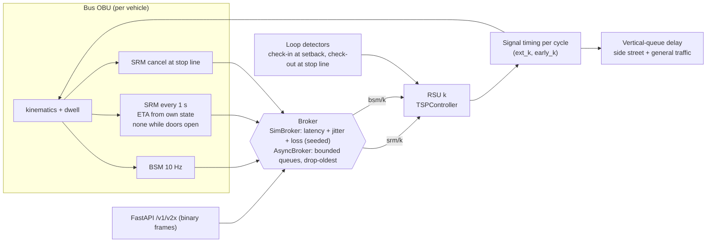
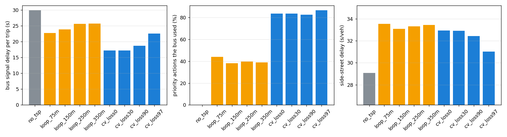

# cits-transit-signal-priority-hub

**Connected-vehicle transit signal priority for a median BRT corridor.** J2735-shaped
BSM/SRM/SSM messages flow through a pub/sub broker (simulated-time with radio latency and
packet loss, or asyncio for live use) to roadside-unit logic that grants **green extension** and
**early green** under side-street minimums, lockout and check-out. A two-hour bidirectional
corridor study compares classic loop-detector TSP at four setbacks with connected TSP from
0% to 97% packet loss.

**Headline (10 seeds × 2 h, paired tests):**

* **Bus signal delay:** connected TSP cut it **42%** (29.9 → 17.2 s/trip), against **14-24%** for loop detectors.
* **Wasted priority:** loops waste most of what they grant. Buses used only **38-44%** of loop-triggered actions, against **83%** for connected TSP.
* **Packet loss:** connected TSP kept a 38% benefit at **90% packet loss**.
* **Side-street cost:** +13% side-street delay under connected TSP.

---

## 1. Problem formulation

TSP is cheap to switch on and easy to get wrong. A check-in loop at a fixed setback assumes the bus
reaches the stop line at a design speed. A **near-side BRT station inside the detection zone**
breaks that assumption: the bus is detected, then dwells for 20 s, and the green it earned is spent on an
empty bus lane. Connected vehicles (V2I) let the on-board unit send continuous ETA updates and cancel
once it clears, but they introduce a radio channel that drops packets.

| Bar | Here |
|---|---|
| **Traffic engineering** | In-cycle TSP (extension and early green from the side-street split, side minimum 15 s, one action per cycle, check-out), near/far-side stations, setback sensitivity, side-street and general-traffic delay under the *realised* timing |
| **Data / experimentation** | 10 seeds with common random numbers (same buses, dwells and traffic across strategies), paired t-tests, loss sweep up to the failure point |
| **Systems** | Binary J2735-style codec, event-driven broker with two backends (deterministic simulated-time channel model, asyncio drop-oldest queues), FastAPI ingest, throughput and latency benchmark |

> **Scope note.** The message layouts use J2735 data elements and units (DE_Speed 0.02 m/s,
> DE_Heading 0.0125°, 1e-7° lat/lon, DSRCmsgID 20/29/30), packed with `struct`, **not** ASN.1 UPER,
> so they are J2735-shaped rather than interoperable with field RSUs. The corridor is synthetic.

---

## 2. Architecture



The RSU also listens to BSMs and **checks out implicitly** once a bus's reported position is past the stop
line. That covers lost cancel messages, so an extension never runs its full length for a bus that has
already gone.

---

## 3. Methodology

### 3.1 In-cycle priority (no transition, no lost coordination)
For cycle $k$ with arterial green $G_a$, the arterial green runs over
$[\,kC-\text{early}_{k-1},\; kC+G_a+\text{ext}_k)$. Priority time always comes out of the same cycle's side
split, so the cycle and offset are untouched:

$$\text{ext}_k \le \min\big(\text{ext}_{max},\; G_s - G_{s,min}\big),\qquad
\text{early}_k \le \min\big(\text{early}_{max},\; G_s - G_{s,min}\big)$$

A request with predicted arrival $T$ (plus a 1-s buffer) gets an **extension** if the arterial green is
running and $T$ falls within reach, an **early green** if $T$ falls before the next arterial start, and
nothing if it already arrives on green. At most one action is granted per cycle, owned by one request;
updates from the same request may lengthen it, and **check-out** ends a running extension immediately.

### 3.2 Detection
* **Loop**: one request when the bus crosses the setback, ETA = setback / 13 m/s; check-out loop at the stop line.
* **Connected**: SRM every 1 s within 300 m of the next signal, ETA from current speed with acceleration to
  cruise. No request while a near-side stop is still ahead or doors are open. A cancel SRM is sent at the stop line.
* **Channel**: 50 ms latency + exponential jitter (10 ms mean), independent loss $p$.

### 3.3 Corridor and measures
1.8 km, 4 signals (C = 100 s, arterial green 52 s, side minimum 15 s, max extension and early green 10 s
each), alternating **near-side** (40 m) and **far-side** (35 m) median stations, 12 buses/h each way,
dwell $\mathcal N(20, 8)$ s, cruise $\mathcal N(13, 1.2)$ m/s. Bus signal delay = time at < 1 m/s within 80 m
of a stop line, excluding dwell. Side-street (450 vph) and arterial general-traffic (1,100 vph, 2 lanes)
delay come from vertical queues served by the realised green windows (2 s start-up loss, 2 s of yellow used).

---

## 4. Results ([`results/brt_corridor/RESULTS.md`](results/brt_corridor/RESULTS.md))

| Strategy | Bus signal delay / trip | Bus travel time | Travel-time SD | Actions used by the bus | Side-street delay | Arterial GP delay |
|---|---|---|---|---|---|---|
| No TSP | 29.9 ± 2.6 s | 309.6 s | 31.8 s | - | 29.1 s | 17.0 s |
| Loop, 75 m | 22.8 (−24%) | 301.4 (−3%) | 29.7 s | 44% | 33.5 (+15%) | 15.5 s |
| Loop, 150 m | 23.9 (−20%) | 301.8 (−3%) | 30.2 s | 38% | 33.1 (+14%) | 15.6 s |
| Loop, 250 m | 25.6 (−15%) | 304.7 (−2%) | 30.7 s | 40% | 33.3 (+15%) | 15.5 s |
| Loop, 350 m | 25.7 (−14%) | 303.6 (−2%) | 30.7 s | 39% | 33.4 (+15%) | 15.5 s |
| **Connected, 0% loss** | **17.2 (−42%)** | **296.6 (−4%)** | **26.0 s** | **83%** | 32.9 (+13%) | 15.5 s |
| Connected, 30% loss | 17.2 (−42%) | 296.6 (−4%) | 26.0 s | 83% | 32.9 (+13%) | 15.6 s |
| Connected, 90% loss | 18.7 (−38%) | 298.0 (−4%) | 26.9 s | 82% | 32.4 (+12%) | 15.8 s |
| Connected, 97% loss | 22.5 (−25%) | 302.9 (−2%) | 30.2 s | 87% | 31.0 (+7%) | 16.2 s |

Every bus-delay and side-street change vs. No TSP is significant at p < 0.05 (paired, 10 seeds).



**Engineering reading.**

* **Setback sensitivity is real but secondary.** Shorter loops did better (−24% at 75 m, −14% at 350 m)
  because a long setback triggers before the near-side station, so the bus then dwells through its own extension.
  At every setback, loops wasted 56-62% of what they granted.
* **The value of V2I is the ETA, not the radio.** Connected TSP issues about the same number of actions as
  loops (85 vs 77-84 per run) but places them where the bus will actually be: 83% are used. It also
  reduces travel-time variability (SD 31.8 → 26.0 s), which riders feel more than the mean.
* **Redundancy makes the channel a non-issue up to about 90% loss.** A bus sends about 20 SRMs on approach;
  one getting through is enough. At 97% loss, requests arrive late or never (41 actions vs 85), and the benefit
  falls to −25%. Repeat rate × horizon is the design lever.
* **The side street pays.** +12-15% delay (29 → 33 s/veh, still LOS C) under every working strategy, and arterial
  general traffic gains slightly (17.0 → 15.5 s) because priority time goes to the arterial phase. Wasted loop
  priority costs the side street just as much as useful priority.

### Systems performance

| Benchmark | Result |
|---|---|
| AsyncBroker fan-out, 200k BSMs × 4 subscribers (publish + decode) | **259k deliveries/s**, p50 1.96 ms, p99 5.2 ms queueing latency |
| SimBroker messages per 2-h connected run | about 65k published |
| Full study (9 strategies × 10 seeds × 2 h) | a few minutes on 2 worker processes |

---

## 5. Repository layout

```
src/tsp_hub/
  messages/j2735.py    BSM / SRM / SSM codec (J2735 units, struct-packed)
  broker/bus.py        SimBroker (seeded channel model) + AsyncBroker (asyncio, drop-oldest)
  signal/controller.py in-cycle TSP controller (extension, early green, lockout, check-out)
  sim/corridor.py      buses, stations, loops, OBU/RSU messaging, realised-timing traffic delay
  services/            study + report
  api/app.py           FastAPI ingest of binary frames + RSU status
  cli.py               study | simulate | bench-broker | serve
configs/corridor.yaml, results/brt_corridor/, tests/ (9 tests)
```

## 6. Reproduce

```bash
python -m venv .venv && .venv/Scripts/activate
pip install -r requirements.txt && pip install --no-deps -e .
pytest
tsp-hub study --workers 2
tsp-hub bench-broker --messages 200000 --subscribers 4
tsp-hub serve --port 8000
```

## 7. Limitations

* Buses run in an exclusive median lane: no general-traffic queue interaction or left-turn conflicts with the busway.
* Fixed-time base timing; no conditional priority (e.g. only for late buses), which agencies often use to limit side-street cost.
* Independent packet loss; real channels lose packets in bursts (Gilbert-Elliott), which would reduce the effective redundancy.

## License

MIT
