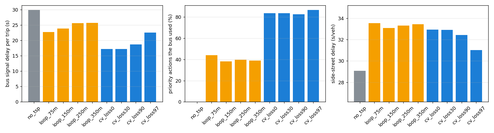

# TSP strategy study

Seeds 11, 23, 37, 41, 59, 67, 73, 89, 97, 101; 2 h per run after a 10-min warm-up; paired t-tests against No TSP (same seeds = same buses, dwells and traffic). n.s. = not significant at 5%.

| Strategy | Bus signal delay / trip (s) | Bus travel time (s) | Travel-time SD (s) | Signal stops / trip | Priority actions / run | Used by the bus | Side-street delay (s/veh) | Arterial GP delay (s/veh) |
|---|---|---|---|---|---|---|---|---|
| No TSP | 29.9 ± 2.6 | 309.6 ± 3.3 | 31.8 ± 2.2 | 3.20 | 0 | - | 29.1 ± 0.3 | 17.0 |
| Loop, 75 m setback | 22.8 ± 3.4 (-24%) | 301.4 ± 4.7 (-3%) | 29.7 ± 2.0 | 2.99 | 84 | 44% | 33.5 ± 0.9 (+15%) | 15.5 |
| Loop, 150 m | 23.9 ± 3.4 (-20%) | 301.8 ± 4.7 (-3%) | 30.2 ± 2.2 | 3.03 | 77 | 38% | 33.1 ± 0.8 (+14%) | 15.6 |
| Loop, 250 m | 25.6 ± 2.9 (-15%) | 304.7 ± 4.5 (-2%) | 30.7 ± 2.2 | 3.10 | 80 | 40% | 33.3 ± 0.8 (+15%) | 15.5 |
| Loop, 350 m | 25.7 ± 3.0 (-14%) | 303.6 ± 4.1 (-2%) | 30.7 ± 2.1 | 3.11 | 82 | 39% | 33.4 ± 0.8 (+15%) | 15.5 |
| Connected, 0% loss | 17.2 ± 1.4 (-42%) | 296.6 ± 2.7 (-4%) | 26.0 ± 2.2 | 2.94 | 85 | 83% | 32.9 ± 0.4 (+13%) | 15.5 |
| Connected, 30% loss | 17.2 ± 1.4 (-42%) | 296.6 ± 2.7 (-4%) | 26.0 ± 2.2 | 2.94 | 85 | 83% | 32.9 ± 0.4 (+13%) | 15.6 |
| Connected, 90% loss | 18.7 ± 1.4 (-38%) | 298.0 ± 3.6 (-4%) | 26.9 ± 1.4 | 3.00 | 72 | 82% | 32.4 ± 0.4 (+12%) | 15.8 |
| Connected, 97% loss | 22.5 ± 2.6 (-25%) | 302.9 ± 4.2 (-2%) | 30.2 ± 3.2 | 3.09 | 41 | 87% | 31.0 ± 0.5 (+7%) | 16.2 |

